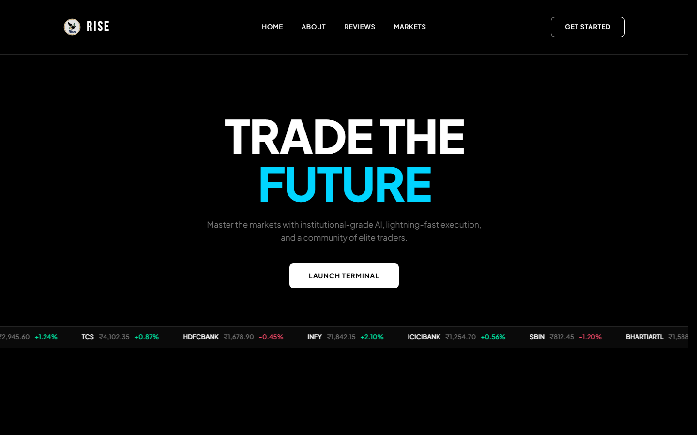
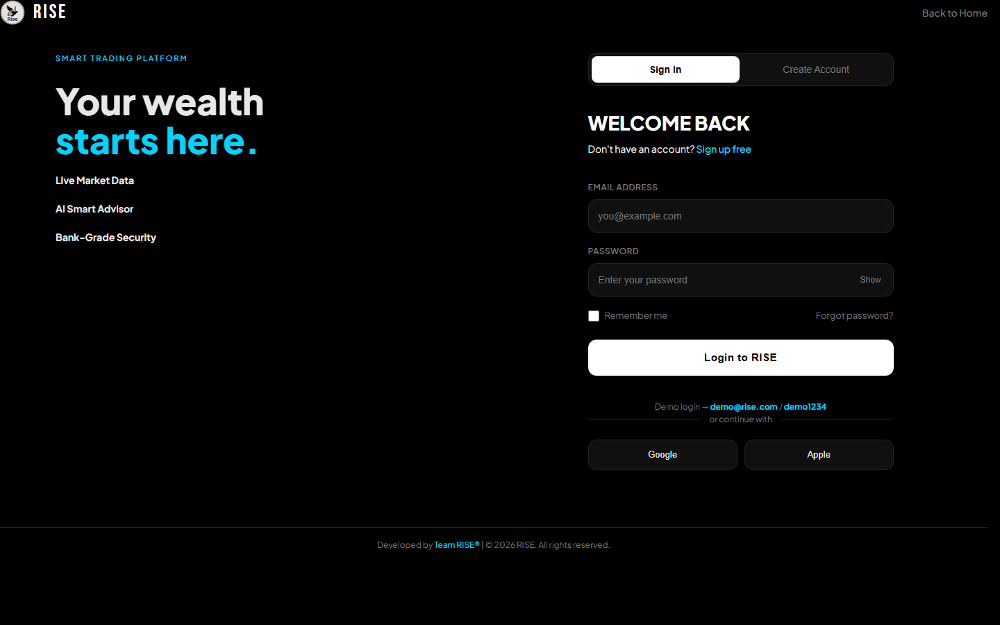

<div align="center">


# RISE

**A practice trading platform for beginners.**

Learn how the stock market works with a virtual $100,000 account — no real money involved.

<br />


</div>

---

## About

RISE is a university group project. It is a single-page React app with four pages:

| Page | What it does |
| :--- | :--- |
| **Home** | Landing page with a scrolling stock ticker, platform features, testimonials and live TradingView charts |
| **Login** | Sign in or create an account, with form validation and a demo account |
| **Welcome** | Greets the signed-in user and shows account stats, market movers and daily tips |
| **Dashboard** | Risk notice, stock table with search, category filter, price sorting and pagination, chart and order panel |

> **Educational demo only.** Prices are sample data and all money is virtual. Nothing in this app is financial advice. Do not trade real money based on it.

---

## Screenshots

<div align="center">

**Home**



<br />

**Login / Register**



</div>

---

## Concepts used

| Concept | Where |
| :--- | :--- |
| Components and props | every page is built from small components (`src/components/`) |
| Client-side routing | React Router, `src/App.jsx` |
| Protected routes | Welcome and Dashboard redirect to Login when signed out |
| Context API | `AuthContext` shares the signed-in user |
| Controlled forms and validation | Login and Create Account forms |
| Custom hooks | `useDebounce`, `usePortfolio` |
| Redux Toolkit | `src/store/`: portfolio (cash, holdings, buy, sell, reset) and watchlist slices |
| Debouncing | Dashboard stock search waits until typing stops |
| Filtering and sorting | category filter, price high to low / low to high |
| Pagination | Dashboard stock table, 5 rows per page |
| Modal | risk notice on the Dashboard |
| localStorage | account, session and the Redux store survive a page refresh |
| Scroll animation | `IntersectionObserver` on the Home page |

---

## Tech stack

| Layer | Choice |
| :--- | :--- |
| Framework | React 19 |
| State | Context API (login), Redux Toolkit (portfolio, watchlist) |
| Build tool | Vite 8 |
| Routing | React Router 7 |
| Styling | Plain CSS with custom properties |
| Icons | Bootstrap Icons |
| Fonts | Bebas Neue, Plus Jakarta Sans |
| Charts | TradingView embed widgets |

---

## Getting started

Requires Node.js 20 or newer.

```bash
git clone https://github.com/eshivansh/RISE.git
cd RISE
npm install
npm run dev
```

Open **http://localhost:5173**. Demo login: `demo@rise.com` / `demo1234`.

| Command | Description |
| :--- | :--- |
| `npm run dev` | Development server with hot reload |
| `npm run build` | Production build into `dist/` |
| `npm run preview` | Serve the production build locally |
| `npm run lint` | Check the code with ESLint |

---

## Project structure

```txt
RISE/
├── docs/screenshots/        README images
├── public/assets/           Logo, images, background video
├── src/
│   ├── main.jsx             Entry: router, auth provider, global styles
│   ├── App.jsx              Route table
│   ├── context/             AuthContext (signed-in user)
│   ├── data/                Sample stock list and page content
│   ├── store/               Redux store, portfolio and watchlist slices
│   ├── hooks/               useDebounce, usePortfolio
│   ├── utils/               Formatting and form validation helpers
│   ├── components/
│   │   ├── ui/              Reusable pieces: Modal, Pagination, StatCard, PriceChange, FormField
│   │   ├── layout/          Layout, Sidebar, ProtectedRoutes
│   │   ├── home/            Home page sections
│   │   ├── auth/            Login and signup forms
│   │   ├── welcome/         Welcome page sections
│   │   └── dashboard/       Dashboard panels
│   ├── pages/               Home, Login, Welcome, Dashboard
│   └── styles/              global.css plus one stylesheet per page
├── index.html
└── vite.config.js
```

### Routes

| Path | Page | Access |
| :--- | :--- | :--- |
| `/` | Home | public |
| `/login` | Login | public |
| `/welcome` | Welcome | signed in |
| `/dashboard` | Dashboard | signed in |

---

## Status

| Area | Status |
| :--- | :--- |
| Home page | ✅ done, being split into components |
| Login / Register | ✅ working, form refactor in progress |
| Shared data, hooks and UI components | ✅ done |
| Shared layout and protected routes | 🔄 in progress |
| Welcome content | 🔄 in progress |
| Dashboard | 🔄 in progress |

### Later

- Live prices from a market data API
- Trading coach chat
- Missions and stock detail pages

---

## Team

| Member | Area |
| :--- | :--- |
| **Shivansh** (lead) | Shared data, hooks and UI components, Dashboard, reviews and merges |
| **Pari** | Routing, layout, authentication, Login page |
| **Aditya** | Home page, Welcome page |

Branches, commit messages and pull requests follow [CONTRIBUTING.md](CONTRIBUTING.md).

<div align="center">
<br />

**Developed by Team RISE**

</div>
